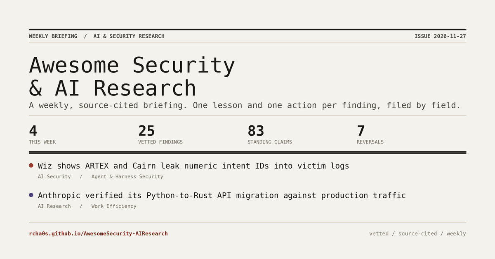

# Awesome Security & AI Research

> A weekly, source-cited briefing on AI security, product security and applied AI research, plus a claim ledger that calls out what the field now believes, what changed and what got overturned.

   

**The site is the product: [rcha0s.github.io/AwesomeSecurity-AIResearch/](https://rcha0s.github.io/AwesomeSecurity-AIResearch/)**. Open the Briefing for this week, Claims for the ledger, Topics to browse by domain. Click any title for the full writeup with its sources; every view and finding has a link you can share.

## Hot incidents

_Only incidents that are critical, covered by 3+ independent outlets, and clear two of: exploited in the wild (CISA KEV counts), 4+ outlets, very common software. Routine advisories and patch roundups never qualify. [Summaries](https://rcha0s.github.io/AwesomeSecurity-AIResearch/hot-incidents.md)._

1. **[NGINX2Root: Unauthenticated remote code execution in nginx, chainable to root on the host](https://rcha0s.github.io/AwesomeSecurity-AIResearch/?hot=nginx2root#week)** · _widely covered, very common software · CVE-2026-123007, CVE-2026-123633 · updated 2026-11-19_
2. **[Java4Shell: Heap overflow in Java's Base64 decoder on AVX-512 CPUs, with claimed pre-auth RCE in Jira, Jenkins and Keycloak](https://rcha0s.github.io/AwesomeSecurity-AIResearch/?hot=java4shell#week)** · _widely covered, very common software · CVE-2026-114938 · updated 2026-11-19_

## Your focus

_Your focus areas, last 7 days: most areas matched first, then newest._

1. **[Highflame's Ramparts scans MCP servers and agent skills for attack paths](https://rcha0s.github.io/AwesomeSecurity-AIResearch/?finding=highflame-s-ramparts-scans-mcp-servers-and-agent-717085ea3d#week)** · _AI Security · Nov 24, 2026_
2. **[UK AISI found a universal jailbreak in pre-release OpenAI GPT-6.2 Astra](https://rcha0s.github.io/AwesomeSecurity-AIResearch/?finding=uk-aisi-found-a-universal-jailbreak-in-pre-relea-25f6e68c00#week)** · _AI Security · Nov 20, 2026_
3. **[Google explains how Duplex phone-calling moved from narrow models to Gemini](https://rcha0s.github.io/AwesomeSecurity-AIResearch/?finding=how-google-duplex-evolved-to-also-call-businesse-31274c5de7#week)** · _AI Research · Nov 20, 2026_

## What to learn

_From the last 14 days: each has proof (the work itself or a measured comparison) and serves one of your goals; more independent sources rank first._

1. **[MobileProbe red-teams mobile GUI agents by placing injections along their actual route](https://rcha0s.github.io/AwesomeSecurity-AIResearch/?finding=mobileprobe-red-teams-mobile-gui-agents-by-placi-63a32851c6#week)** · _AI Security · Nov 12, 2026_
2. **[Microsoft finds 8% of coding sessions account for 44% of costs](https://rcha0s.github.io/AwesomeSecurity-AIResearch/?finding=microsoft-research-focus-edition-98-87946c1829#week)** · _AI Research · Nov 12, 2026_

## Biggest this week

_Most covered in the last 7 days; single-outlet patch notices are left out._

1. **[PHP releases fix 18 flaws, including critical remote code execution bugs](https://rcha0s.github.io/AwesomeSecurity-AIResearch/?finding=php-releases-fix-18-flaws-including-critical-rem-ea5748b555#week)** · _Product Security · Nov 19, 2026 · 10 sources_
2. **[OpenJDK Base64 decoder flaw Java4Shell corrupts memory on AVX-512 CPUs](https://rcha0s.github.io/AwesomeSecurity-AIResearch/?finding=java4shell-remote-code-execution-in-openjdk-cve-3ce305735b#week)** · _Product Security · Nov 17, 2026 · 8 sources_
3. **[F5 patches five critical NGINX flaws as public exploit code appears](https://rcha0s.github.io/AwesomeSecurity-AIResearch/?finding=f5-patches-critical-nginx2root-flaws-as-poc-expl-ab56579d9e#week)** · _Product Security · Nov 19, 2026 · 7 sources_

## This week's top stories

_The last 7 days, most covered first._

1. **[New unpatched PHP RCE (CVE-2026-115560) is separate from PHP2Shell](https://rcha0s.github.io/AwesomeSecurity-AIResearch/?finding=php-shares-mitigation-for-new-rce-vulnerability-17a56684d0#week)** · _Product Security · Nov 19, 2026 · 4 sources_
2. **[N-able takes hosted N-central offline after researcher publishes 33 zero-day exploits](https://rcha0s.github.io/AwesomeSecurity-AIResearch/?finding=n-able-takes-hosted-n-central-offline-after-rese-5b959f2d42#week)** · _Product Security · Nov 17, 2026 · 5 sources_
3. **[Attackers exploit critical Cisco Expressway flaw to breach a Russian organization](https://rcha0s.github.io/AwesomeSecurity-AIResearch/?finding=attackers-exploit-critical-cisco-expressway-flaw-53c39d492b#week)** · _Product Security · Nov 20, 2026 · 3 sources_

## Claim changes

_3 changes in the last 7 days; earlier ones fill in, each with its date._

1. **Added:** [Harness choice alone can double an agent's cost](https://rcha0s.github.io/AwesomeSecurity-AIResearch/?claim=harness-overhead-sets-agent-cost#claims) · _current · Nov 18, 2026 · 2 sources_  
   On the same model and task, the harness alone changed cost up to about 2x at similar accuracy, and coding agents' first call ranges from about 1.9k to 32k input tokens.
2. **Added:** [Learn per-repo cost controls from past coding agent runs](https://rcha0s.github.io/AwesomeSecurity-AIResearch/?claim=learn-per-repo-cost-controls#claims) · _current · Nov 18, 2026 · 1 source_  
   A controller that learns from earlier runs in the same repository which tools to prune, which short notes to inject and when to stop unproductive failure loops cut coding-agent cost by 18-31% on…
3. **Added:** [Use one-hour cache markers when sessions pause over five minutes](https://rcha0s.github.io/AwesomeSecurity-AIResearch/?claim=one-hour-cache-for-paused-sessions#claims) · _current · Nov 18, 2026 · 2 sources_  
   Harnesses that write 5-minute prompt-cache markers re-buy their whole context after an idle gap longer than five minutes, while harnesses with 1-hour markers kept about 86% cache hits after a…
4. **Last reversal:** [Constrained decoding wins for structured output, not TOON](https://rcha0s.github.io/AwesomeSecurity-AIResearch/?claim=constrained-decoding-for-structured-output#claims) · _current · Jul 28, 2026 · 1 source_  
   Replaces ~~Assumed TOON's input savings would carry to generation~~: Benchmarked head-to-head, plain JSON generation had the best one-shot and final accuracy while constrained decoding used the fewest tokens; TOON was outperformed by constrained decoding even on…

## Efficiency

_Where agent harnesses still waste tokens or time, and what to change. [Harness feed](https://rcha0s.github.io/AwesomeSecurity-AIResearch/efficiency.md)._

- [Harness choice alone can double an agent's cost](https://rcha0s.github.io/AwesomeSecurity-AIResearch/?claim=harness-overhead-sets-agent-cost#claims) · _updated Nov 18, 2026_
- [Learn per-repo cost controls from past coding agent runs](https://rcha0s.github.io/AwesomeSecurity-AIResearch/?claim=learn-per-repo-cost-controls#claims) · _updated Nov 18, 2026_
- [Use one-hour cache markers when sessions pause over five minutes](https://rcha0s.github.io/AwesomeSecurity-AIResearch/?claim=one-hour-cache-for-paused-sessions#claims) · _updated Nov 18, 2026_
- [Keep intermediate tool results out of the model context](https://rcha0s.github.io/AwesomeSecurity-AIResearch/?claim=keep-bulk-tool-output-out-of-context#claims) · _updated Nov 9, 2026_

## Explore

### [Briefing](https://rcha0s.github.io/AwesomeSecurity-AIResearch/#week) · [Stories](https://rcha0s.github.io/AwesomeSecurity-AIResearch/#news) · [Claims](https://rcha0s.github.io/AwesomeSecurity-AIResearch/#claims) · [Topics](https://rcha0s.github.io/AwesomeSecurity-AIResearch/#topics) · [Archive](https://rcha0s.github.io/AwesomeSecurity-AIResearch/#archive) · [Methodology](https://rcha0s.github.io/AwesomeSecurity-AIResearch/#methodology)

On GitHub: [AI Security](ai-security/README.md) · [Product Security](product-security/README.md) · [AI Research](ai-research/README.md) · [Claims](claims/README.md) · [Newsletter](NEWSLETTER.md) · [Trends](TRENDS.md) · [Review queue](REVIEW.md) · [Harness Engineering stream](docs/streams/harness-engineering.md)

## Contribute

- **Suggest a source:** [open an issue](https://github.com/rcha0s/AwesomeSecurity-AIResearch/issues/new) with the feed or account URL. Sources join the ranked registry through a reviewed PR (`python scripts/add_source.py`).
- **Challenge a claim:** [open an issue](https://github.com/rcha0s/AwesomeSecurity-AIResearch/issues/new) with the evidence that refines or refutes it.
- **Work on the pipeline:** [CONTRIBUTING.md](CONTRIBUTING.md) · [AGENTS.md](AGENTS.md) (layout, tests, automation) · [PUBLISH.md](PUBLISH.md).

Content is [CC BY 4.0](LICENSE), scripts MIT; linked research belongs to its authors.

Last updated 2026-11-24 by <code>scripts/generate_site.py</code> from the pools in <code>data/</code>. Generated - do not hand-edit.
