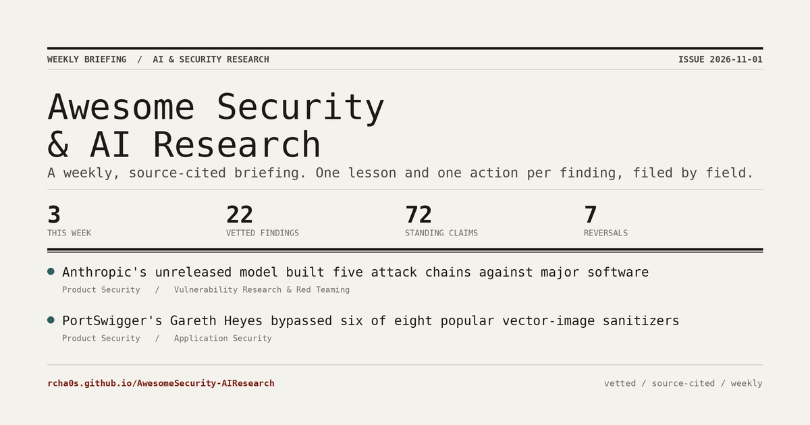

# Awesome Security & AI Research

> A weekly, source-cited briefing on AI security, product security and applied AI research, plus a claim ledger that calls out what the field now believes, what changed and what got overturned.

   

**The site is the product: [rcha0s.github.io/AwesomeSecurity-AIResearch/](https://rcha0s.github.io/AwesomeSecurity-AIResearch/)**. Open the Briefing for this week, Claims for the ledger, Topics to browse by domain. Click any title for the full writeup with its sources; every view and finding has a link you can share.

## Your focus

_Your focus areas, last 7 days: most areas matched first, then newest._

1. **[Microsoft shows poisoned fine-tuning data and checkpoints hijack coding agents' tools](https://rcha0s.github.io/AwesomeSecurity-AIResearch/?finding=microsoft-shows-poisoned-fine-tuning-data-and-ch-8d4cff91d3#week)** · _AI Security · Nov 12, 2026_
2. **[OpenAI trained GPT-6 Astra on automated-red-team jailbreaks to resist misuse](https://rcha0s.github.io/AwesomeSecurity-AIResearch/?finding=openai-trained-gpt-6-astra-on-automated-red-team-37a2be5c2d#week)** · _AI Security · Nov 12, 2026_
3. **[JioStar architect says production evals need a validated judge and monitoring](https://rcha0s.github.io/AwesomeSecurity-AIResearch/?finding=jiostar-architect-says-production-evals-need-a-v-6fce70a740#week)** · _AI Research · Nov 11, 2026_

## Biggest this week

_Most covered or exploited in the last 7 days._

1. **[GPUStack treated spoofable loopback requests as admin, and attackers exploited it](https://rcha0s.github.io/AwesomeSecurity-AIResearch/?finding=gpustack-treated-spoofable-loopback-requests-as-a9d1c4073c#week)** · _AI Security · Nov 9, 2026_
2. **[IBM Aspera Faspex authorization bypass gives full admin, exploited in the wild](https://rcha0s.github.io/AwesomeSecurity-AIResearch/?finding=ibm-aspera-faspex-authorization-bypass-gives-ful-50dbb7e5d4#week)** · _Product Security · Nov 9, 2026_
3. **[N-able investigates new N-central exploits that work against hotfixed on-premise servers](https://rcha0s.github.io/AwesomeSecurity-AIResearch/?finding=n-able-investigates-new-n-central-exploits-that-2c3354cb8c#week)** · _Product Security · Nov 13, 2026 · 3 sources_

## This week's top stories

_The last 7 days, newest first._

1. **[Google Project Zero shortens its disclosure deadline to 30 days by 2028](https://rcha0s.github.io/AwesomeSecurity-AIResearch/?finding=google-project-zero-shortens-its-disclosure-dead-d17af9292c#week)** · _Product Security · Nov 13, 2026_
2. **[StepSecurity finds fake-interview npm look-alikes stayed on npm for seven months](https://rcha0s.github.io/AwesomeSecurity-AIResearch/?finding=stepsecurity-finds-fake-interview-npm-look-alike-223ab43764#week)** · _Product Security · Nov 13, 2026_
3. **[XBOW and Onapsis help uncover 14 SAP NetWeaver vulnerabilities patched in November](https://rcha0s.github.io/AwesomeSecurity-AIResearch/?finding=xbow-and-onapsis-help-uncover-14-sap-netweaver-v-3d41496692#week)** · _Product Security · Nov 13, 2026_

## Claim changes

_3 changes in the last 7 days; earlier ones fill in, each with its date._

1. **Added:** [Output-only watermark audits can be evaded by the audited provider](https://rcha0s.github.io/AwesomeSecurity-AIResearch/?claim=output-only-watermark-audits-are-evadable#claims) · _current · Nov 9, 2026 · 1 source_  
   Data-use audits that detect training-data watermarks only through a model's outputs can be defeated by a non-compliant provider that reshapes logits at inference time, leaving weights unchanged and…
2. **Added:** [Poisoned optimizer feedback can plant trigger rules in agent Skills](https://rcha0s.github.io/AwesomeSecurity-AIResearch/?claim=skill-optimization-feedback-can-plant-backdoors#claims) · _current · Nov 9, 2026 · 1 source_  
   When agent Skills are rewritten by a text-space optimizer from reference answers, an attacker who poisons only those reference answers can induce a persistent trigger-to-payload rule in the final…
3. **Added:** [Coding-agent permission files leak secrets into public repositories](https://rcha0s.github.io/AwesomeSecurity-AIResearch/?claim=agent-permission-files-leak-secrets#claims) · _current · Nov 8, 2026 · 1 source_  
   Coding agents that persist approved shell commands verbatim (such as Claude Code's .claude/settings.local.json) store any password or token typed in those commands in plaintext project files, and…
4. **Last reversal:** [Constrained decoding wins for structured output, not TOON](https://rcha0s.github.io/AwesomeSecurity-AIResearch/?claim=constrained-decoding-for-structured-output#claims) · _current · Jul 28, 2026 · 1 source_  
   Replaces ~~Assumed TOON's input savings would carry to generation~~: Benchmarked head-to-head, plain JSON generation had the best one-shot and final accuracy while constrained decoding used the fewest tokens; TOON was outperformed by constrained decoding even on…

## Efficiency

_Where agent harnesses still waste tokens or time, and what to change._

- [Send simple subagent jobs to a cheaper model](https://rcha0s.github.io/AwesomeSecurity-AIResearch/?claim=cheaper-models-for-simple-subagent-jobs#claims)
- [Compact near the context limit; reset only if the model needs it](https://rcha0s.github.io/AwesomeSecurity-AIResearch/?claim=compact-first-reset-only-if-the-model-needs-it#claims)
- [Return short tool responses and distilled subagent summaries](https://rcha0s.github.io/AwesomeSecurity-AIResearch/?claim=concise-tool-responses-and-subagent-summaries#claims)
- [Keep intermediate tool results out of the model context](https://rcha0s.github.io/AwesomeSecurity-AIResearch/?claim=keep-bulk-tool-output-out-of-context#claims)

## Explore

### [Briefing](https://rcha0s.github.io/AwesomeSecurity-AIResearch/#week) · [Stories](https://rcha0s.github.io/AwesomeSecurity-AIResearch/#news) · [Claims](https://rcha0s.github.io/AwesomeSecurity-AIResearch/#claims) · [Topics](https://rcha0s.github.io/AwesomeSecurity-AIResearch/#topics) · [Archive](https://rcha0s.github.io/AwesomeSecurity-AIResearch/#archive) · [Methodology](https://rcha0s.github.io/AwesomeSecurity-AIResearch/#methodology)

On GitHub: [AI Security](ai-security/README.md) · [Product Security](product-security/README.md) · [AI Research](ai-research/README.md) · [Claims](claims/README.md) · [Newsletter](NEWSLETTER.md) · [Trends](TRENDS.md) · [Review queue](REVIEW.md)

## Contribute

- **Suggest a source:** [open an issue](https://github.com/rcha0s/AwesomeSecurity-AIResearch/issues/new) with the feed or account URL. Sources join the ranked registry through a reviewed PR (`python scripts/add_source.py`).
- **Challenge a claim:** [open an issue](https://github.com/rcha0s/AwesomeSecurity-AIResearch/issues/new) with the evidence that refines or refutes it.
- **Work on the pipeline:** [CONTRIBUTING.md](CONTRIBUTING.md) · [AGENTS.md](AGENTS.md) (layout, tests, automation) · [PUBLISH.md](PUBLISH.md).

Content is [CC BY 4.0](LICENSE), scripts MIT; linked research belongs to its authors.

Last updated 2026-11-13 by <code>scripts/generate_site.py</code> from the pools in <code>data/</code>. Generated - do not hand-edit.
