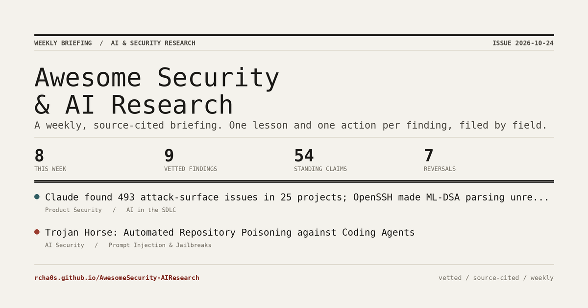

# Awesome Security & AI Research

> A weekly, source-cited briefing on AI security, product security and applied AI research, plus a claim ledger that calls out what the field now believes, what changed and what got overturned.

   

**The site is the product: [rcha0s.github.io/AwesomeSecurity-AIResearch/](https://rcha0s.github.io/AwesomeSecurity-AIResearch/)**. Open the Briefing for this week, Claims for the ledger, Topics to browse by domain. Click any title for the full writeup with its sources; every view and finding has a link you can share.

## This week's top stories

_The last 7 days, newest first._

1. **[Claude wrote machine-checked no-crash proofs for 239 OSS-Fuzz entry points across 123 libraries at the RISC-V binary level by turning fuzz harnesses into specs](https://rcha0s.github.io/AwesomeSecurity-AIResearch/?finding=claude-wrote-machine-checked-no-crash-proofs-for-fea71adcaf#week)** · _Product Security · Oct 22, 2026_
2. **[Sentry's Next.js tunnelRoute skipped middleware for everything under the tunnel path, not just the requests its rewrite served (GHSA-mchm-gjx6-7h55)](https://rcha0s.github.io/AwesomeSecurity-AIResearch/?finding=sentry-s-next-js-tunnelroute-skipped-middleware-d6a38416b8#week)** · _Product Security · Oct 22, 2026_
3. **[Pillow DoS: a 5.6 KB MIC file hangs n\_frames at 100% CPU (GHSA-22hg-r758-rrw9)](https://rcha0s.github.io/AwesomeSecurity-AIResearch/?finding=ghsa-22hg-r758-rrw9-7a9523be43#week)** · _Product Security · Oct 21, 2026_

## Claim changes

_3 changes in the last 7 days; earlier ones fill in, each with its date._

1. **Added:** [Auto-evolved harness gains are mostly overfitting](https://rcha0s.github.io/AwesomeSecurity-AIResearch/?claim=harness-evolution-gains-need-held-out-attribution#claims) · _current · Oct 21, 2026 · 1 source_  
   Gains from automatically evolving an agent harness (prompts, skills, tools, orchestration around a fixed model) are mostly search-set overfitting and extra inference compute: across 21 settings with…
2. **Contested:** [Diff review catches more LLM-introduced defects than full-file review](https://rcha0s.github.io/AwesomeSecurity-AIResearch/?claim=diff-review-catches-more-than-full-file-review#claims) · _contested · Oct 21, 2026 · 2 sources_  
   Reviewing an LLM's proposed change as a diff catches more defects than reviewing the resulting full file.
3. **Contested:** [TOON beats JSON on input-side token cost](https://rcha0s.github.io/AwesomeSecurity-AIResearch/?claim=toon-cuts-input-tokens-vs-json#claims) · _contested · Oct 21, 2026 · 4 sources_  
   For large uniform arrays, TOON serializes to 30-60% fewer input tokens than JSON at comparable retrieval accuracy.
4. **Overturned:** [Constrained decoding wins for structured output, not TOON](https://rcha0s.github.io/AwesomeSecurity-AIResearch/?claim=constrained-decoding-for-structured-output#claims) · _current · Jul 28, 2026 · 1 source_  
   Replaces ~~Assumed TOON's input savings would carry to generation~~: Benchmarked head-to-head, plain JSON generation had the best one-shot and final accuracy while constrained decoding used the fewest tokens; TOON was outperformed by constrained decoding even on…

## Explore

### [Briefing](https://rcha0s.github.io/AwesomeSecurity-AIResearch/#week) · [Stories](https://rcha0s.github.io/AwesomeSecurity-AIResearch/#news) · [Claims](https://rcha0s.github.io/AwesomeSecurity-AIResearch/#claims) · [Topics](https://rcha0s.github.io/AwesomeSecurity-AIResearch/#topics) · [Archive](https://rcha0s.github.io/AwesomeSecurity-AIResearch/#archive) · [Methodology](https://rcha0s.github.io/AwesomeSecurity-AIResearch/#methodology)

On GitHub: [AI Security](ai-security/README.md) · [Product Security](product-security/README.md) · [AI Research](ai-research/README.md) · [Claims](claims/README.md) · [Newsletter](NEWSLETTER.md) · [Trends](TRENDS.md) · [Review queue](REVIEW.md)

## Contribute

- **Suggest a source:** [open an issue](https://github.com/rcha0s/AwesomeSecurity-AIResearch/issues/new) with the feed or account URL. Sources join the ranked registry through a reviewed PR (`python scripts/add_source.py`).
- **Challenge a claim:** [open an issue](https://github.com/rcha0s/AwesomeSecurity-AIResearch/issues/new) with the evidence that refines or refutes it.
- **Work on the pipeline:** [CONTRIBUTING.md](CONTRIBUTING.md) · [AGENTS.md](AGENTS.md) (layout, tests, automation) · [PUBLISH.md](PUBLISH.md).

Content is [CC BY 4.0](LICENSE), scripts MIT; linked research belongs to its authors.

Last updated 2026-10-24 by <code>scripts/generate_site.py</code> from the pools in <code>data/</code>. Generated - do not hand-edit.
